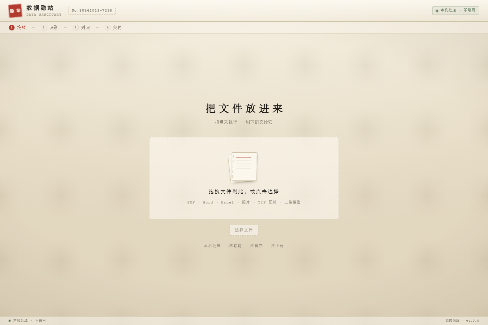
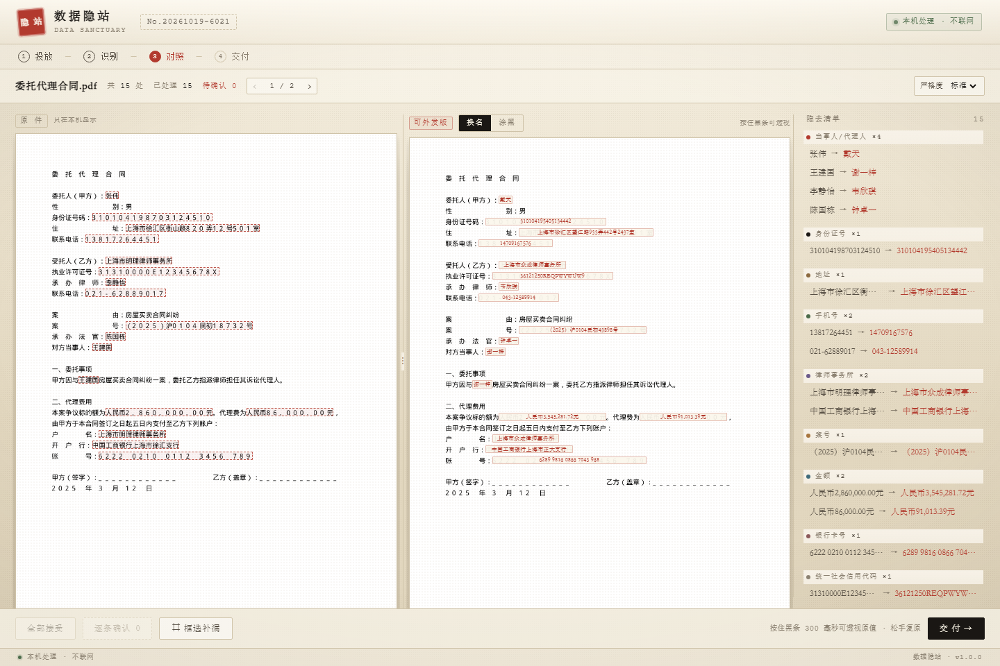
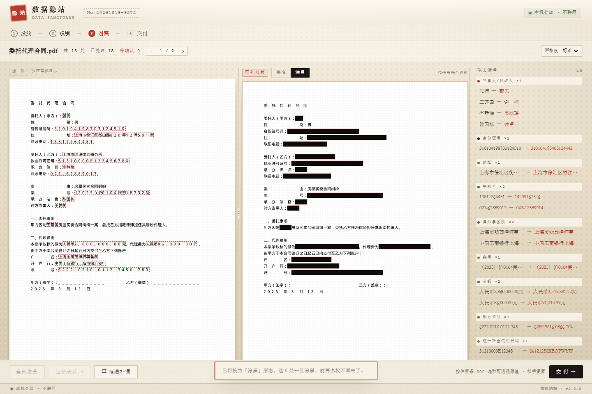
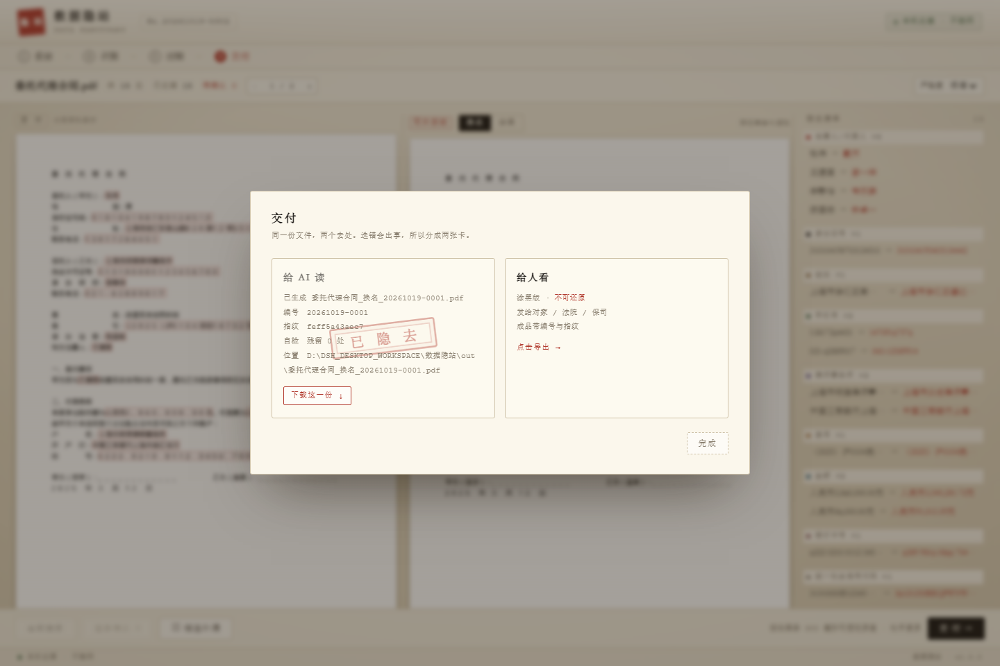
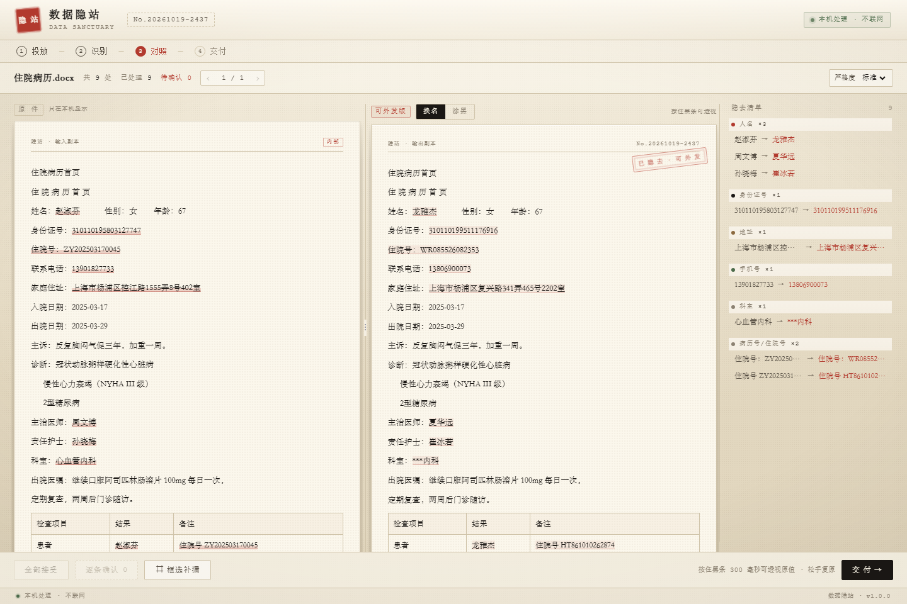

# 数据隐站 · Sanitized_Data

> 把敏感抹掉，让文件放行。

> 当前版本 **v1.2.0**（2026-10-23）· Windows 桌面安装包 / 绿色版 / 源码运行 ·
> 优先看：[安装与卸载指南](docs/install-guide.md) · [v1.2.0 发布说明](docs/release-notes-v1.2.0.md)

律师、医生、财务要把文件喂给豆包 / Kimi / WorkBuddy，但文件里有当事人姓名、身份证号、病历号、客户账号。
**数据隐站**在本机把这些内容换掉或涂黑，只把处理过的版本交出去。

- 全程本地：只监听 `127.0.0.1`，引擎不发起任何外呼
- 两个出口：**换名版**（可还原，给 AI 读）、**涂黑版**（不可还原，给人看）
- 出口自检：导出后对成品再跑一遍检测，原文还在就拒绝交付

## 看一眼

| 投放 | 对照台 |
|---|---|
|  |  |

左边是原件（红框标出识别到的敏感处），右边是可外发版，两栏同步滚动，右侧是隐去清单。
漏了的用「⌗ 框选补漏」补；按住黑条 300 毫秒可透视原值，松手复原。

| 涂黑形态 | 交付 |
|---|---|
|  |  |

Word / Excel / 文本走**流式排版**（不是页面截图），表格单元格也会按值替换；Excel 额外做表头列级（姓名/证件/手机/地址/账号列整列处理）与纯数值金额（导出写回数字，公式/求和可用）：



---

## 快速开始

```powershell
# Windows
pip install -r app\server\requirements.txt
双击「启动.bat」          # 或 start.bat

# Linux / macOS
pip3 install -r app/server/requirements.txt
chmod +x start.sh && ./start.sh
```

浏览器会自动打开 `http://127.0.0.1:8760`（端口被占会顺延到 8840）。

> **Windows 用户不想装 Python？** 直接用桌面安装包 `Sanitized_Data_Setup_1.2.0_x64.exe`
> 或绿色版，双击即用；安装/卸载/升级见 [docs/install-guide.md](docs/install-guide.md)。

**用法**：首页 →「打开控制台」→ 把文件拖进纸堆 → 等识别 → 左右对照 → 漏了的用「框选补漏」→ 交付。

启动后控制台会打印解析器、OCR 状态、数据目录和实际端口；`Ctrl+C` 退出，退出时自动清掉上传副本和预览中间件。

### 站点结构

| 路径 | 页面 | 说明 |
|---|---|---|
| `/` | 首页 | 介绍、入口、能力概览 |
| `/console` | 控制台 | 主工作区（投放 / 识别 / 对照 / 交付） |
| `/download` | 下载 | Windows 桌面安装包 / 绿色版、校验值、部署说明（源码包已下架） |
| `/mcp` | MCP 接入 | 让 Claude Desktop / Cursor 等 Agent 自动脱敏 |

左上角的印章和「数据隐站」是回到首页的链接，控制台顶栏也有「首页 / 下载 / MCP 接入」导航。

### Linux 启动参数

```bash
./start.sh                            # 仅本机访问（默认 127.0.0.1:8760）
./start.sh --host 0.0.0.0             # 监听所有网卡（对外提供服务时用）
PORT=9000 ./start.sh                  # 指定端口
BIND_HOST=0.0.0.0 ./start.sh          # 也可用环境变量
```

---

## MCP 接入

`app/server/mcp_server.py`（安装版为 `Sanitized_Data_MCP.exe`）是一个 stdio 的 MCP 服务，
让支持 MCP 的 Agent 在把文件交给模型之前先调用本机脱敏。

| 工具 | 作用 |
|---|---|
| `sanitize_document` | 脱敏一个本地文件，返回可外发副本路径（旧契约冻结，新增 job_id/origin/workbench_url） |
| `redact_text` | 就地脱敏一段文本（适合发日志/报错前过一遍） |
| `check_support` / `list_rules` | 检查格式 / 列出规则包 |
| `sanitize_file` + `get_sanitize_job` + `get_sanitize_entities` | Job 化：建任务、轮询、查实体（默认不回原值） |
| `update_sanitize_entity` / `mark_sanitize_region` / `accept_all_sanitize_entities` | 复核：接受/拒绝/替换/框选补漏 |
| `export_sanitize_job` / `get_sanitize_audit` / `rehydrate_sanitize_text` | 导出、审计链校验、本机还原 |
| `open_sanitize_workbench` | 返回 `http://127.0.0.1:<端口>/console?job=<id>` 深链，打开同一 Job |

另提供 `sanitize://jobs/...` resources 与 `review-before-export` / `workbench-fallback` prompts。
MCP 优先通过本机 Web 服务共享 Job（同一审计/成品/深链），Web 未启动时回退本地 JobManager。

Claude Desktop 的 `claude_desktop_config.json`（源码运行）：

```json
{
  "mcpServers": {
    "sanitized-data": {
      "command": "python",
      "args": ["D:\\Sanitized_Data\\app\\server\\mcp_server.py"]
    }
  }
}
```

安装版可直接把 `command` 指向
`%LOCALAPPDATA%\Programs\Sanitized_Data\Sanitized_Data_MCP.exe`（args 留空）。
DSH 集成（`@deepseek-ai/dsh-mcp-client` 的 patch 写法、工具名 `mcp__sanitized-data__*`）见
[docs/impl/mcp.md](docs/impl/mcp.md)；完整配置/验证步骤见 `/mcp` 页面。

DSH 原生体验（工具卡 + 左下角「数据隐站工作台」真实 WebUI）用随包插件：

```powershell
# 安装包安装后：%LOCALAPPDATA%\Programs\Sanitized_Data\dsh-plugin\install.ps1
# 源码运行：
powershell -ExecutionPolicy Bypass -File integrations\dsh-plugin-sanitize-detect\install.ps1 -Profile desktop
```

重启 DSH 后侧边栏底部出现「脱敏检测」；卸载加 `-Uninstall`。详见
[docs/impl/mcp.md §5.1](docs/impl/mcp.md)。

---

## 服务器部署

仓库里的 `deploy/` 带两个文件：

| 文件 | 用途 |
|---|---|
| `deploy/sanitized-data.service` | systemd 开机自启 |
| `deploy/nginx.conf` | HTTPS 反向代理示例 |

```bash
sudo cp deploy/sanitized-data.service /etc/systemd/system/
sudo systemctl daemon-reload && sudo systemctl enable --now sanitized-data
```

**反向代理必须透传真实域名**，否则服务端的同源校验会把正常请求判成跨站：

```nginx
proxy_set_header Host              $http_host;
proxy_set_header X-Forwarded-Host  $host;
client_max_body_size 512m;
```

服务端做的是「主机名比较」（忽略协议和端口），并优先信任 `X-Forwarded-Host`，
所以 `https://cka.blctek.com:8443` → 后端 `cka.blctek.com` 这种组合是能通过的。
如果还有问题，可以用环境变量显式放行：

```bash
YINZHAN_ALLOWED_ORIGINS="https://cka.blctek.com:8443" ./start.sh
```

### 日志与状态监控

服务端不再只有「页面打不开」：**启动、就绪、每个请求、错误、心跳（默认 5 分钟）、退出**
都会写到本地文件日志，部署后可直接定位问题。

| 文件 | 说明 |
|---|---|
| `data/logs/server.log` | 当前日志（始终 tail 这个） |
| `data/logs/server-YYYY-MM-DD.log` | 按日期翻转的历史日志，默认保留最近 30 个（约 30 天） |

> 翻转是惰性的：每天 0 点后的第一条日志触发切档；默认 5 分钟心跳保证切换延迟 ≤ 5 分钟。
> 若关闭心跳且长期无请求，跨天日志可能延后归档，但不影响当前日志继续写入。

```bash
tail -f data/logs/server.log                  # 实时看
grep -E '\[(ERROR|CRITICAL)\]' data/logs/server.log
python app/server/status.py                   # 进程/健康/心跳/今日错误摘要
python app/server/status.py --json            # 给 cron/监控系统（健康=退出码 0）
journalctl -u sanitized-data -f               # systemd 自己的 console 日志
```

`status.py` 只读本地文件，最多向 `127.0.0.1` 的 `/api/health` 发一次 GET，不访问外网。
日志只记运维事实：请求行只有 method/path/status/耗时/字节数，**query string、请求体、
上传文件名、文档内容都不落日志**；客户端 IP 默认不记。

| 环境变量 | 默认 | 作用 |
|---|---|---|
| `YINZHAN_LOG_DIR` | `<数据目录>/logs` | 日志目录 |
| `YINZHAN_LOG_LEVEL` | `INFO` | DEBUG / INFO / WARNING / ERROR |
| `YINZHAN_LOG_KEEP_DAYS` | `30` | 历史日志按日归档保留个数（约 30 天）；0 = 不清理 |
| `YINZHAN_LOG_REQUESTS` | `1` | 0 = 关闭逐请求日志 |
| `YINZHAN_LOG_HEARTBEAT_SEC` | `300` | 心跳间隔秒数；0 = 关闭 |
| `YINZHAN_LOG_CLIENT_IP` | `0` | 1 = 请求日志记客户端 IP（反代取第一跳） |
| `YINZHAN_LOG_STDERR` | 自动 | 0 = 关闭控制台同步输出 |

日志写不进去时先回退 `<数据目录>/logs`，仍不可写才降级为仅 stderr，服务照常启动。
设计细节与排查命令见 [docs/impl/logging.md](docs/impl/logging.md)。

---

## 桌面版

桌面版把「本机服务 + 界面」打包成一个双击即用的应用，用户不需要装 Python。

| 产物 | 说明 |
|---|---|
| `Sanitized_Data_Setup_1.2.0_x64.exe` | Windows x64 安装包（Inno Setup）：装到 `%LOCALAPPDATA%\Programs\Sanitized_Data`，**不需要管理员权限**；自动检查/静默补齐 WebView2 与 VC++ 运行库 |
| `Sanitized_Data-1.2.0-win64-portable.zip` | Windows x64 绿色版：解压后直接运行 `Sanitized_Data.exe`，免安装 |
| `Sanitized_Data-1.1.2-arm64.dmg` | macOS Apple Silicon（M 系列）DMG：ad-hoc 签名测试包，拖入 Applications 即用；首次打开需右键 → 打开（未公证） |
| `Sanitized_Data-1.1.2-x64.dmg` | macOS Intel DMG：ad-hoc 签名测试包，同上 |
| `dist/Sanitized_Data/` | PyInstaller onedir 构建目录（绿色版解压前的目录形态） |

安装包体积 / SHA-256 随 [v1.2.0 发布说明](docs/release-notes-v1.2.0.md) 的发布记录给出。

| 文件 | 作用 |
|---|---|
| `desktop/main.py` | 启动器：单实例检查 → 起服务 → 原生窗口 → 退出清理 |
| `desktop/app.spec` | PyInstaller 打包配置（onedir） |
| `desktop/build_win.ps1` | Windows 一键打包：装依赖 → 打包 → 补 VC++ DLL → 自检 → 出安装包 |
| `desktop/installer.iss` | Inno Setup 安装包，自动检查并静默补齐 WebView2 / VC++ |
| `desktop/fetch_redist.ps1` | 拉取 WebView2 与 VC++ 运行库安装文件 |
| `.github/workflows/build-macos.yml` | macOS 免签名测试包（GitHub Actions：macos-15 arm64 / macos-15-intel） |
| `app/server/yinzhan/paths.py` | 资源/数据目录解析，区分源码运行、桌面版、环境变量覆盖 |

详细说明：

- 安装 / 卸载 / 升级 / 数据位置 / 断网 / 排障：[docs/install-guide.md](docs/install-guide.md)
- v1.2.0 发布说明（MCP L2 产品体验：15 工具/资源/深链/DSH 工具卡与真实工作台 browser tab；身份证校验位异常兜底）：[docs/release-notes-v1.2.0.md](docs/release-notes-v1.2.0.md)
- v1.1.3 发布说明（AI 换名版可读性/一致性、检测增强、YuNet 侧脸、日志/状态可观测性）：[docs/release-notes-v1.1.3.md](docs/release-notes-v1.1.3.md)
- v1.1.2 发布说明（P2/P3：扫描件 verify 零 OCR 快检、warning 去重、整页证件收紧、异常大码框待确认、TIF rasterio Orientation 修复）：[docs/release-notes-v1.1.2.md](docs/release-notes-v1.1.2.md)
- v1.1.0 发布说明（相对 v1.0.0 的新能力与已知限制）：[docs/release-notes-v1.1.0.md](docs/release-notes-v1.1.0.md)
- 格式与能力口径表（自动 / 待确认 / 不支持）：[docs/support-matrix.md](docs/support-matrix.md)
- 规划与分期：[docs/desktop-plan.md](docs/desktop-plan.md)
- 构建与分发包（含 macOS 免账号测试包）：[docs/desktop-build.md](docs/desktop-build.md)

> 桌面版默认把数据放在 `%LOCALAPPDATA%\Sanitized_Data`（Windows）或
> `~/Library/Application Support/Sanitized_Data`（macOS），可用 `YINZHAN_DATA_DIR` 覆盖；
> 导出成品在该目录下的 `out/`。安装版**程序目录与数据目录分离**，卸载程序不会删除数据目录。
> 源码运行和服务器部署行为不变，仍用产品目录下的 `data/`。

---

## 支持的文件

| 格式 | 解析 | 涂黑 | 换名 | 说明 |
|---|---|---|---|---|
| PDF（有文本层） | ✓ | ✓ 真删除 | ✓ | `apply_redactions` 重写内容流；默认剥离附件/批注/表单/JS（`keep_pdf_hidden` 可保留）；**文本层页内嵌图片若检出人脸/证件/车牌/码等敏感目标，整块图片区域涂黑** |
| PDF（扫描件） | ✓ OCR | ✓ | ✓ | 无文本层自动转 OCR；页面图像也过人脸/证件/车牌/码类扫描 |
| Word `.docx` | ✓ | ✓ | ✓ | 清修订/批注/作者；表格可做表头列级脱敏；**内嵌图片自动检测敏感目标并涂黑回写；图表/文本框/OLE 等隐藏对象导出前确认，strict 可剥离** |
| Excel `.xlsx` | ✓ | ✓ | ✓ | 清隐藏表/定义名/批注；表头列级 + 纯数值单元格（金额写回数字）；**内嵌图片自动脱敏；图表/OLE 隐藏对象导出前确认** |
| 图片 `.png/.jpg` | ✓ OCR | ✓ | ✓ | 重编码，剥离 EXIF/GPS；**自动按 EXIF Orientation 转正**（手机竖拍不再躺倒） |
| TIF 正射影像 | ✓ | ✓ | ✓ | 剥离地理标签（Geo / EXIF / XMP / ICC 与 `.tfw`/`.prj`/`.aux.xml`/`.ovr`/`.kml` 等 sidecar）；坐标可中性化为 LOCAL_CS（GIS 可打开、无真实坐标）；图面文字/视觉目标可打码；Pillow 路径按 Orientation 转正 |
| 纯文本 `.txt/.md/.csv/.tsv/.log` | ✓ | ✓ | ✓ | CSV/TSV 支持列语义（表头列级/多级/合并表头继承）；导出保持原分隔符/引号/列数 |
| 三维 `.obj/.ply/.glb/.stl` | ✓ 文本 | 部分 | — | 仅注释/名称等文本清理 + OBJ/PLY 顶点平移；GLB 只做 JSON 等长覆盖、STL 只置零头部；**OSGB / 3D Tiles / LAS-LAZ / 贴图与 MTL 不支持** |

> 三维只覆盖桌面中间格式的有限清理（综合完成度约 20%），**不承诺真实倾斜摄影（OSGB / 3D Tiles / LAS-LAZ）交付**；完整口径见 [docs/support-matrix.md](docs/support-matrix.md)。

### 图片 / 扫描页里的敏感目标（OCR 读不到，靠图像扫描）

| 目标 | 处理方式 | 状态 |
|---|---|---|
| 人脸 | **YuNet 主检测 + Haar 补充**；大图长边 >1600 自动分块；照片/正射保留 1200 长边侧脸补检；涂黑范围为**整个头**（发际线/耳廓/下颌），不是只遮眼睛鼻子 | 默认直接处理；强侧脸/遮挡漏检会提示人工复核/整图涂黑 |
| 证件 | 身份证/护照/驾驶证/营业执照/社保卡/工作证/居住证/港澳居民来往内地通行证/台湾居民来往大陆通行证/外国人永久居留身份证/银行卡 OCR 锚点命中；**身份证默认「关键字段」档：正面遮头像、姓名、身份证号、住址，反面遮签发机关、有效期**；其他证件整卡/整区域涂黑，可选「整卡涂黑」严格档。PDF 文本页不再因标题词整页误伤 | 默认直接处理（身份证字段定位失败会自动回退整卡；银行卡不整页扩张） |
| 车牌 | OCR 正则 + 完整牌面色块检测（蓝/绿/黄底）；检测不到时回退 OCR 框并提示可能只覆盖文字 | 默认待确认 |
| 二维码 / 条形码 | 10 种码制，默认一律打码、不保存解码内容；`/detect` 仅检测且面积 >5% 页面的低置信候选不自动打码，提示人工确认 | 默认直接处理 |
| 红色公章 / 签署区 / 手写签名 | 红章与签署区自动涂黑；手写签名/手写批注进待确认 | 红章/签署区自动，其余待确认 |
| 整页兜底 | 对照台「⊘ 整图涂黑」一键整页不可逆覆盖（图片/TIFF/PDF 可用） | 手动 |

> 「整图涂黑」用于窗外景观、室内装修、镜面反光、指纹/虹膜等无法自动识别的场景；这类内容不做自动承诺。

### 聊天截图 / 门牌路牌店招 / 未成年人 / 组合风险（P1-A）

| 能力 | 行为 | 边界 |
|---|---|---|
| **聊天截图逐项** | 识别微信式聊天截图，逐项涂黑：联系人/自己头像、昵称、群名称、状态栏/消息时间、底部输入框 | 仅图片、需 OCR 文本；WhatsApp/Slack/折叠屏等自定义皮肤可能漏或框偏；发票/照片/名片已做 0 误报负样本 |
| **门牌/路牌/店招/单位铭牌** | OCR 可读时识别牌面区域，默认「待确认」涂黑，清单可撤销 | 无 OCR/白色招牌/竖排手写/远距小字不承诺自动；普通文档/合同/名片不触发 |
| **未成年人提示** | 从身份证号生日推断 <14 → 对照台红色提示；人工点「启用严格模式」后证件整卡 + 全部实体强制涂黑（不可换名还原） | 只做身份证生日推断，不做人脸年龄估计；未检出时不显示 |
| **精确时间模糊化** | 投放开关（默认关）：只把「完整日期+时刻」里的时刻替换成时段（如 19:28→晚上），日期保留 | 只处理有完整日期的时刻；纯状态栏时间/无日期时间暂不自动 |
| **组合风险提示** | 同一媒体出现 ≥2 类准标识符（位置/证件/人脸/车辆/联系人/时间）时黄色提示 + 一键整图涂黑 | 只提示不自动改；不承诺消除重识别 |
| **YuNet 侧脸模型** | **已随包**（OpenCV Zoo，232KB，模型文件 MIT）：侧脸/低头/闭眼/合影召回显著提升（真实照片主脸 8/13→12/13）；仍不承诺 100% | 模型卡注明训练数据为 WIDER FACE（CC BY-NC-ND）；商用/对客分发前建议法务再确认该数据许可；运行完全离线 |

### P1-B：Office 内嵌图 / CSV/TSV / PDF 内嵌图

| 能力 | 行为 | 边界 |
|---|---|---|
| **Office 内嵌图片自动脱敏** | DOCX/XLSX 里 `word/media`、`xl/media` 图片：扫人脸/证件/车牌/二维码/条码/聊天/招牌，命中即按框涂黑并 zip 回写；成品重开复检命中 0 | 只处理图片里的视觉/码类目标；图片里的**纯文字 OCR 规则**列 P1.5；无命中图片保留并 warning |
| **Office 隐藏对象** | 图表/文本框/OLE/activeX/不可解码图片等枚举为「隐藏对象」，导出前确认（`allow_unprocessed_media`），strict 可剥离 | strict 会改变文档外观；剥离失败会阻断导出；XFA/SmartArt/SVG 文本未专门处理 |
| **CSV/TSV 列语义** | 表头列级脱敏；两级/合并表头继承；导出按原分隔符/引号写回、行/列数不变；`.tsv` 可直接解析 | 无表头时退化为普通规则；BOM/GBK 编码保留列 P1 |
| **PDF 内嵌图** | 文本层页里面积 ≥5% 的图片：扫人脸/证件/车牌/码/聊天/招牌；视觉无命中时再做**图片内纯文字 OCR 规则检测**（手机号/邮箱/身份证号等），命中则整块图片区域涂黑；成品黑像素复检 | 只处理文本层页；图片内文字需印刷体且 OCR 可读；旋转页/同页 >8 图/异常格式建议人工复核 |
| **P1.5 补充** | Office 内嵌图片增加**纯文字 OCR 规则**（印刷体手机号/身份证号/邮箱/金额等，命中即按文字框涂黑）；证件类型扩到 11 类；护照号规则；CSV/TSV 保留原编码/BOM/换行 | 文字 OCR 受预算限制（默认 30 张/60s/篇，可 env 调）；中文手写/艺术字/低分辨率不承诺；CSV 未知编码回退 UTF-8+warning |

### 身份证脱敏档位（A 方案）

投放/对照台可选「证件脱敏（身份证）」两档：

| 档位 | 遮什么 | 适用 |
|---|---|---|
| **关键字段（默认）** | 正面：头像、姓名、身份证号、住址；反面：**签发机关、有效期**。性别/民族/出生等保留 | 给法院、保险、银行、对方律所等特定接收方核验身份 |
| **整卡涂黑** | 整卡/整页不透明覆盖（正反两面都覆盖） | 公开发布、不确定接收方、上传给不特定 AI 服务 |

- 正面/反面字段定位成功才按关键字段处理；**定位失败会自动回退整卡**并提示，避免漏遮。
- 关键字段档只是去标识化，不承诺"满足《个人信息保护法》/匿名化"；公开或不受控场景仍建议整卡。

### OCR 读不出来的东西

扫描合同里最要命的三样东西，文字识别是抓不到的，靠图像特征单独处理：

| 类型 | 怎么找 | 处理方式 |
|---|---|---|
| **红色公章 / 私章** | 印泥是彩色的、扫描字是灰的：算 `R-(G+B)/2`，块级聚合后按印章尺寸过滤 | 直接涂黑（19/19 检出） |
| **落款签署区** | 页面上出现「单位名称 / 盖章 / 代表人 / 签字」等短标签，且不少于两条 | 整块涂黑，含公司名、印章、签名、日期 |
| **手写签名** | 抠掉 OCR 已识别的文字框，剩下的深色墨迹团块 | 标为「手写签名」，待确认 |
| **手写批注/编号** | OCR 置信度 < 0.85 的短行 | 标为「疑似手写」，待确认 |

后两类默认进「待确认」，因为墨迹判断可能误报；印章和签署区默认直接处理。


---

## 两种导出，别选错

| | 给 AI 读 | 给人看 |
|---|---|---|
| 样子 | 张三 → 陈志远 | ██████ |
| 能不能还原 | 能（映射表加密存在本机） | 不能 |
| 用在哪 | 豆包、Kimi、WorkBuddy | 发给对家、法院、保司 |
| 文件位置 | `out/xxx_换名_日期-序号.pdf` | `out/xxx_已隐去_日期-序号.pdf` |

**涂黑不是画黑框。** 导出时会真正删除内容流里的文字，再用 `PyMuPDF` 重写整页 —— 复制粘贴拿不到原文。

---

## 规则包

`app/server/yinzhan/rules/*.yaml` 里放规则，启动时自动加载，**改完不用重启**（按文件 mtime 热更新）。

当前默认启用：`common` / `finance-cn` / `legal-cn` / `medical-cn` / `trade-cn` / `geo-cn`，以及 PIPL 补充包 `pipl-cn`（社交/聊天 ID、快递、票号、VIN、IMEI/SN/MAC、IP、门牌、航班车次座位等）和 `table-cn`（Excel/Word 表头列级）。

```yaml
pack: legal-cn
name: 法律 · 民事诉讼
rules:
  - id: cn.idcard
    entity: ID_CARD
    label: 身份证
    level: L3
    scope: [pdf, docx, xlsx, text, image, tiff]
    detect:
      - {type: regex, pattern: '(?<!\d)[1-9]\d{5}(19|20)\d{2}...', validate: cn_id_checksum}
    replace: {strategy: mask, keep: [head6, tail4]}
```

新增一个实体类型：

1. 在任意 `*.yaml` 里加一条规则
2. 如果要用新的检测方式，在 `detectors/` 里加一个类并 `register_detector`
3. 如果要新的替换方式，在 `replacers/` 里加一个函数并 `register_replacer`

管线、界面、导出都不用改。

---

## 架构

```
浏览器控制台  ──同源 HTTP──▶  本地引擎 (Python)
                                │
                     Parse → Detect → Plan → Apply → Verify
                                │
                     ┌──────────┴──────────┐
                  解析器插件            规则包 YAML
                  (parsers/)            (rules/)
                                │
                     加密映射库 / 审计链 / 出口自检
```

- 界面和引擎在同一个进程里，但**文件永不经过浏览器**：浏览器只拿渲染好的页面图和实体坐标。
- 引擎没有外呼代码；上传只写本机临时目录，任务结束即删。
- 审计只记「类型 + 数量 + 文件名/哈希 + PDF 隐藏数据清理痕迹」，不记内容原值；源文件名本身若含个人信息（如「张三_身份证.jpg」），当前默认导出名仍沿用原文件名，请先改名或等下一版文件名清洗策略（用户已列入待定项）。

---

## 安全边界（要说清楚）

**能保证**

- 处理过程不发一个网络包
- 导出是破坏性重写，不是盖黑框
- 元数据（作者、设备、GPS、地理参考）会被剥离
- 审计记录带 HMAC 链，改一条后续全废

**不能保证**

- 同机恶意软件、内存抓取、屏幕录制
- 「去标识化」不等于「匿名化」。国标语境下去标识化数据仍属个人信息，本产品只说「已隐去」，不说「已合规」
- 地理数据只能「降密」：坐标移了，河流道路的形状还在

---

## 自检

```powershell
# 生成样例
python app\tests\make_samples.py

# 端到端：解析 → 检测 → 导出 → 复检
cd app\server
python ..\tests\e2e.py
```

最近一次自检结果（5 个样例，全部通过；对账单因新增表头列级/数值金额识别从 13 处增至 19 处）：

| 文件 | 格式 | 识别 | 换名导出 | 涂黑导出 |
|---|---|---|---|---|
| 委托代理合同.pdf | pdf · 2 页 | 15 处 | 残留 0 | 残留 0 |
| 住院病历.docx | docx | 9 处 | 残留 0 | 残留 0 |
| 对账单.xlsx | xlsx | 19 处 | 残留 0 | 残留 0 |
| 名片.png | image（OCR） | 6 处 | 残留 0 | 残留 0 |
| 正射影像.tif | tiff | 3 处 | 残留 0 | 残留 0 · 地理标签已剥离 |

界面也在真实浏览器里跑通了完整链路：拖入 → 识别 → 对照 → 换名/涂黑切换 → 交付 → 成品落盘并自检。

---

## 已知限制

| 限制 | 说明 |
|---|---|
| 人名/机构识别靠启发式 | 没有内置大模型，宁少报不误报；漏掉的用框选补 |
| 身份证反面 | 关键字段模式现在也会遮反面签发机关/有效期；若反面字段定位失败则回退整卡（宁可多遮） |
| 证件字段定位 | 只有证件占画面较大、锚点可读、朝向为 90° 整数倍时才能稳定分字段；小卡远景/透视过大/OCR 读不出正面锚点会自动回退整卡（宁可多遮） |
| 人脸大图漏检 | 常规检测按长边 640 + YuNet 1600 长边主检测；长边 >1600 自动分块，照片/正射再补侧脸。2026-10-22 真实照片主脸 **12/13**（YuNet 随包后），仍可能漏被裁切的边缘侧脸/极小脸/严重遮挡。会提示「请人工复核/整图涂黑」，不承诺 100% 召回 |
| 聊天截图 | 仅微信式布局 + 图片 OCR；自定义皮肤/纯图标输入条可能漏；建议收集真实聊天截图补充测试集 |
| 门牌路牌店招 | 仅 OCR 可读且非白底时识别；无文字场景走整图/人工框选 |
| 未成年人/时间/组合风险 | 未成年人只做身份证生日推断（<14 提示，人工开启严格模式）；不做人脸年龄估计；时间模糊默认关且只处理完整日期+时刻；组合风险只提示不自动改 |
| 准标识符与场景照片 | 车牌默认待确认；门牌/路牌/店招/单位铭牌仅在 OCR 可读时触发；聊天截图仅微信式布局；精确时间默认关；组合风险只提示不自动改；窗外景观/镜面反光/指纹等无法自动识别的走框选或整图涂黑 |
| 文件名可能含个人信息 | 当前导出名沿用源文件名（默认命名策略待用户确认后再改）；文件名含姓名/证件号时请先改名 |
| Office 内嵌图片 | 已自动脱敏图片里的视觉/码类目标及**印刷体文字规则**（手机号/身份证号/邮箱/金额等）；中文手写/艺术字/低分辨率文字不承诺；文字 OCR 有预算（30 张/60s/篇）；无命中图片保留（可能仍带 EXIF/GPS）；图表/文本框/OLE 等隐藏对象仍需导出前确认（strict 可剥离，会改变外观） |
| PDF 内嵌图片 | 只处理**文本层页**里面积 ≥5% 的图片；视觉+印刷体文字 OCR 命中即整块黑；图片内手写/艺术字 P1.6；旋转页/同页>8 图/异常格式建议人工复核 |
| CSV/TSV | 无表头时退化为普通规则；**导出保留原编码/BOM/换行**（UTF-8/UTF-8 BOM/GB18030/UTF-16；未知编码回退 UTF-8+warning）；`.txt/.md` 仍 UTF-8 |
| PDF 隐藏数据 | 附件/批注/表单/JS 默认剥离；如确需保留附件，API 可用 `keep_pdf_hidden=true`（需知情，敏感原文仍会被出口自检拦截） |
| 三维只做有限处理 | 只支持 `.obj/.ply/.glb/.stl` 的文本/注释清理与 OBJ/PLY 顶点平移（GLB 仅 JSON 等长覆盖、STL 头置零）；贴图/MTL/GLB 内嵌图、OSGB、3D Tiles、LAS-LAZ 均不支持；三维结构化 verify 与预览为 0，综合完成度约 20%，**不承诺真实倾斜摄影交付** |
| TIF 坐标中性化 | 已实现 LOCAL_CS 中性化（GIS 可打开、无真实坐标），中性化参数可逆；`strip` 模式彻底去参考；多帧 TIFF 只剥离不中性化（明确 warning） |
| TIF Orientation | v1.1.2 起 Pillow 与 rasterio 两条路径 parse/render/export 都按 tag 274 转正（Orientation 1–8），成品不再带 274；rasterio 大图路径的中性化地理变换已同步旋转/交换宽高 |
| 扫描件 OCR 精度 | 清晰扫描件够用，手写体和低分辨率照片会漏 |
| XLSX 宏 | `.xlsm` 导出后不保留宏（会告警） |
| 安装包 | v1.2.0 Windows 安装包 / 绿色版（`Sanitized_Data_Setup_1.2.0_x64.exe` / `Sanitized_Data-1.2.0-win64-portable.zip`），装到用户目录、无需管理员；**未做代码签名**，SmartScreen / 杀软可能提示「未知发布者」，体积与 SHA-256 见发布说明 |

---

## 目录

```
Sanitized_Data/
├─ 启动.bat / start.bat     Windows 双击启动
├─ start.sh                 Linux / macOS 启动
├─ deploy/
│  ├─ sanitized-data.service  systemd 单元
│  └─ nginx.conf              HTTPS 反代示例
├─ app/
│  ├─ server/               引擎
│  │  ├─ CONTRACT.md        模块契约（改代码先看这个）
│  │  ├─ run.py             入口
│  │  ├─ mcp_server.py      MCP 服务（stdio）
│  │  └─ yinzhan/
│  │     ├─ udm.py          统一文档模型
│  │     ├─ pipeline.py     五段管线
│  │     ├─ jobs.py         任务状态机
│  │     ├─ api.py          HTTP 接口
│  │     ├─ parsers/        格式插件
│  │     ├─ detectors/      检测插件
│  │     ├─ replacers/      替换插件
│  │     └─ rules/          规则包
│  ├─ web/                  站点（离线，无 CDN）
│  │  ├─ home.html          首页
│  │  ├─ index.html         控制台
│  │  ├─ download.html      下载页
│  │  ├─ mcp.html           MCP 接入页
│  │  └─ downloads/         安装包（Windows zip / Linux tar.gz）
│  └─ tests/                自检脚本
├─ samples/                 测试文件
├─ out/                     导出的成品
└─ data/                    运行时数据（密钥、映射、审计库）
```

---

## 常见问题

**为什么 OCR 慢？**
首次识别要加载模型（约 2 秒），之后常驻内存。扫描件多的文件会明显慢于文本层 PDF。

**换名之后模型答错了怎么办？**
换名版是可还原的。`data/vault/` 里存着加密映射，把模型回答存成文本后：

```powershell
python app\server\rehydrate.py --list                      # 看有哪些换名版
python app\server\rehydrate.py --job j_ab12cd34 回答.txt    # 还原成 回答_还原.txt
```

**能不能不装 Python？**
可以：Windows 用户用桌面安装包（`Sanitized_Data_Setup_1.2.0_x64.exe`）或绿色版即可，Python 运行时与 OCR 模型已打进程序，不需要本机装 Python（安装包约 160 MB，精确体积/SHA-256 见 [v1.2.0 发布说明](docs/release-notes-v1.1.3.md)）。安装步骤见 [docs/install-guide.md](docs/install-guide.md)。源码运行仍需 Python 3.10+。

**端口被占了？**
自动从 8760 往后找，实际端口写在 `data/runtime.json`。

**部署后完全没有反馈 / 页面打不开？**
先跑状态脚本（会给出进程、`/api/health`、心跳、今日错误和日志尾部）：

```bash
python app/server/status.py
```

再实时看本地日志：

```bash
tail -f data/logs/server.log
journalctl -u sanitized-data -n 100 --no-pager
```

启动行（`start`）出现后没有 `ready`，说明卡在 OCR 加载或端口绑定；有 `ready` 但请求不进来，
查 nginx 反代与 `data/runtime.json` 里的端口；日志最后一行停在很久以前且没有心跳，
说明进程已退出或卡死。

**部署到服务器后，上传文件报「跨站请求被拒绝」？**
这是服务端的防 CSRF 校验：它比对浏览器发来的 `Origin` 和请求的 `Host`。
反向代理把 `Host` 改写掉之后两者对不上，就会被拦。

服务端现在的判定逻辑是「只比主机名，忽略协议和端口」，并优先看 `X-Forwarded-Host`，
所以常见的三种情况都能过：

| 场景 | 结果 |
|---|---|
| 直连 `http://127.0.0.1:8760` | 通过 |
| 反代 `Host $host`（端口被剥掉） | 通过 |
| 反代 `Host` 被改写，但带 `X-Forwarded-Host` | 通过 |
| 真正的跨站请求 | 拦截并写入 `data/logs/server.log`（WARNING） |

还不行就显式放行：

```bash
YINZHAN_ALLOWED_ORIGINS="https://cka.blctek.com:8443" ./start.sh
```

对应的 nginx 配置必须包含：

```nginx
proxy_set_header Host              $http_host;
proxy_set_header X-Forwarded-Host  $host;
client_max_body_size 512m;
```

**对外提供服务怎么启动？**
`./start.sh --host 127.0.0.1`（只监听本机，由 nginx 提供 HTTPS）。
不要把引擎直接绑 `0.0.0.0` 暴露到公网——它没有账号体系。

**扫描件为什么慢？能中途停吗？**
扫描件没有文本层，只能一页一页跑离线 OCR。当前默认用 **PP-OCRv6 small**，
现场实测（6 核 CPU、A4 扫描页、42 页测试集）**约 2.1 秒/页**，整套 87 秒。
v1.1.2 起扫描件导出后的**自检不再整册重跑 OCR**：改用低 DPI 渲染 + 逐矩形像素复检
（零 OCR），多页扫描件全链路耗时约降 45%–58%（10–17 页扫描件 85–112s → 35–61s）。
界面上会显示「正在识别第 3/17 页（扫描件）· 约剩 1 分钟」，**随时可以点「换一个文件」中断**，
后端会立刻停止当前页之后的处理。

几个可调项：

| 环境变量 | 默认 | 作用 |
|---|---|---|
| `YINZHAN_OCR_MAX_SIDE` | 1600 | OCR 输入最长边。调小更快，但小字可能丢 |
| `YINZHAN_OCR_DESKEW` | 0 | 纠偏（实测对 PP-OCR 无提升，默认关） |
| `YINZHAN_OCR_CLAHE` | 1 | 低对比度页自动增强 |

**想再快/再准还能做什么？**
- 快：换 `rapidocr-openvino` 走 OpenVINO（Intel CPU 才有效，AMD 无收益）
- 准：把 `rec_small` 换成 server 版模型（体积 80MB+，速度慢 3–5 倍）
- 手写：PP-OCR 系列对连笔手写无能为力，目前靠"墨迹检测 + 人工确认"兜底

**浏览器报 WinError 10054？**
那是浏览器先断开（刷新、关页、等不及）造成的，不是服务出错。已静音处理，
真正的服务端异常会写到 `data/logs/server.log`（`[ERROR]` 行 + 堆栈）。
