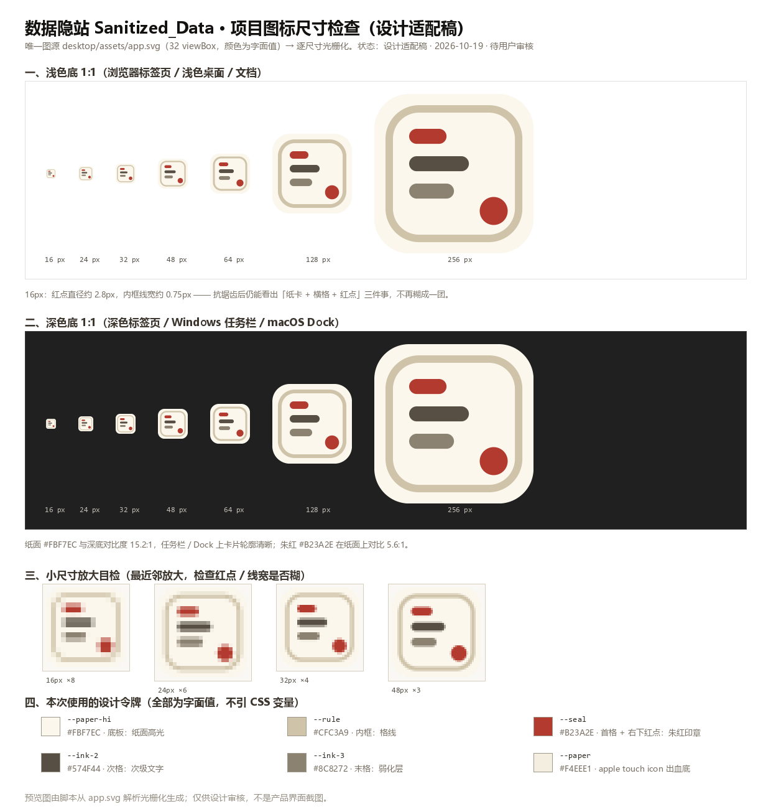
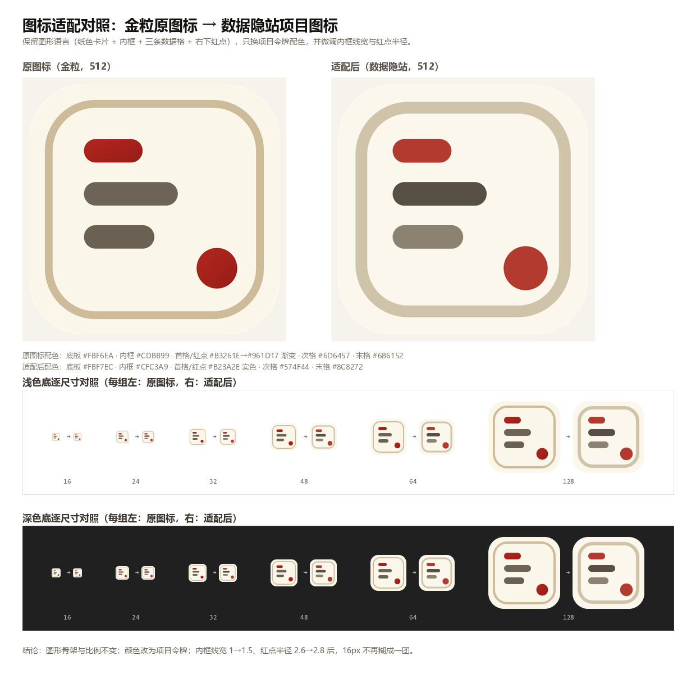

# 06 · 图标适配检查与替换记录：金粒图标 → 数据隐站项目图标

> **状态：设计适配稿 · 2026-10-19**（待用户审核后再视为定稿）
> 执行：前端设计师 `designer-icon`（task-6，本批唯一允许改代码/资产的任务）
> 仓库：`D:\DSH_DESKTOP_WORKSPACE`（HEAD `fb90233`，项目根 `Sanitized_Data/`）
> 结论：**已完成并通过全部自动化校验 + 本地 favicon 冒烟**。图形语言保留，配色改为项目设计令牌，内框线宽与红点半径做了两处小尺寸微调；`dist/`、`dist_installer/` 未重打包（下次构建自动生效）。

---

## 1. 任务与边界

用户把「金粒」项目的三份图标文件放在项目根目录，要求先做配色/尺寸评审，适配成 `Sanitized_Data`（数据隐站）的项目图标后再替换：

| 输入文件（用户放置，**不删、不改名**） | 说明 |
|---|---|
| `金粒图标.svg` | 32 viewBox，纸色卡片 + 内框 + 三条数据格 + 右下红点；颜色为字面值 `#fbf6ea` / `#cdbb99` / `#b3261e→#961d17` / `#6d6457` / `#6b6152` |
| `金粒图标.ico` | 6 帧全 PNG 编码：16/24/32/48/64/256 |
| `微信图片_20261019231013_94_29.png` | 512×512 渲染图（原图标视觉基准） |

本批**只做图标适配与接入**，边界：

- ✅ 新增图标资产、4 个页面的 `<head>` 图标链接、`app.spec` / `installer.iss` 的图标配置、本记录与预览图。
- ❌ 不重打包 `dist/`（约 315 MB）、不重打 `dist_installer/`。
- ❌ 不改 `desktop/main.py`（已核实 `webview.create_window(...)` **没有 `icon` 参数**，窗口图标由 exe 资源决定，见 §10）。
- ❌ 不改 `app/server/yinzhan/api.py`：静态文件服务已覆盖新文件，MIME 实测正确（见 §9.3）。
- ❌ 不提交 git；三份用户原文件保持 untracked。

---

## 2. 设计依据

| 依据 | 摘取 | 对图标的要求 |
|---|---|---|
| README 品牌句 | 「把敏感抹掉，让文件放行。」 | 图标要同时表达「文件」与「被抹掉/封存」 |
| DESIGN.md 4.1（L337 起） | 材质=米白纸张、牛皮纸档案袋；符号=编号戳、骑缝章、机密红章、色带 | 保留纸色卡片、内框（格线）、朱红印章点 |
| DESIGN.md 4.2（L353 起） | `--paper` `#F4EEE1`、`--paper-hi` `#FBF7EC`、`--paper-lo` `#E6DCC6`、`--ink` `#1A1714`、`--ink-2` `#574F44`、`--ink-3` `#8C8272`、`--rule` `#CFC3A9`、`--seal` `#B23A2E`、`--seal-hi` `#D9543F`、`--black` `#0D0B09`、`--ok` `#4C6B4A` | 所有颜色必须来自上表令牌，不能自造色 |
| 站点 CSS | `app/web/site.css:4-9`、`app/web/style.css:6-9` 的 `:root` 与令牌完全一致；`.seal` 用 `background:var(--seal)` 实色 | 图标红点/首格与站点「隐站」印章同色，扁平实色 |
| DESIGN.md 4.6 / 4.7（L508 起） | 动效与可访问性规范 | 图标是静态资产，不涉及动效；图形不靠颜色编码状态（色盲友好要求不冲突），红/灰同时有明度差 |

**图形语言保留**（与金粒原图逐值对应，只动颜色与两处小尺寸几何）：

- 纸色圆角卡片：`rect 0,0,32,32 rx=7`
- 内框：`rect`（见 §6 微调）
- 三条数据格：`x=7`，宽 7.5 / 12 / 9，高 3，`rx=1.5`，纵向 y=7 / 12.5 / 18
- 右下红点：圆心 `(24, 23.5)`

---

## 3. 配色映射表（图标原色 → 项目令牌）

ΔE 采用 CIEDE2000（D65、sRGB→Lab），对比度采用 WCAG 相对亮度公式。所有令牌的字面值取自 `app/web/site.css` 的 `:root`。

| 图元 | 金粒原色 | 项目令牌 | 改用字面值 | 处理 | 理由与量化依据 |
|---|---|---|---|---|---|
| 底板（圆角卡片） | `#FBF6EA` | `--paper-hi` | `#FBF7EC` | **替换** | ΔE2000 **0.57**，肉眼不可分；语义就是「纸面高光」。深色任务栏上纸面与 `#202020` 对比 **15.2:1**，卡片轮廓清晰。备选 `--paper #F4EEE1`（ΔE2000 1.72）会让卡片发暗、与站点正文纸底同色，故不用 |
| 内框描边 | `#CDBB99` | `--rule` | `#CFC3A9` | **替换** | ΔE2000 **3.57**，仍是同色系「纸面格线」；对纸面对比 1.63:1。它是装饰性细线、不承载信息（WCAG 非文本对比要求不适用于纯装饰），所以不把它加深成 `--ink-3`，以免破坏「淡淡格线」质感 |
| 首格（红条） | `#B3261E → #961D17` 渐变 | `--seal` | `#B23A2E` | **替换（渐变改实色）** | 原渐变两端 ΔE2000 仅 6.1，在 3/32 高的窄条里不可辨；站点 `.seal` 印章用 `--seal` 实色，图标跟随以保持「同一个朱红」。实色 `#B23A2E` 与原亮端 `#B3261E` 的 ΔE2000 为 **3.39**（观感连续），对纸面对比 **5.55:1**，16px 下更「实」 |
| 右下红点 | 同上渐变 | `--seal` | `#B23A2E` | **替换（渐变改实色）** | 同首格。红点与首格同色，取「印章红」；16px 直径 2.8px 时实色比渐变稳定 |
| 次格（第二条） | `#6D6457` | `--ink-2` | `#574F44` | **替换** | 令牌语义「次级文字」。对比由 5.43:1 提到 **7.52:1**，16px 更稳；与原色 ΔE2000 7.60，属同族加深 |
| 末格（第三条） | `#6B6152` | `--ink-3` | `#8C8272` | **替换** | 令牌语义「弱化 / 占位」。与原色 ΔE2000 13.04，是**有意拉开层次**：原图两灰格 ΔE2000 仅 **1.43**（肉眼几乎同色），本批按令牌语义分层次格。对比 **3.53:1** ≥ 3:1（非文本图形下限），放大预览确认 16px 仍可辨 |

**未启用的令牌及原因**（避免「为用而用」）：

- `--seal-hi #D9543F`：对纸面对比 3.71:1 偏亮，会把「印章」变成「高亮提示」；站点里它是扫描线/悬停高亮专用，图标不用。
- `--ink #1A1714`、`--black #0D0B09`：太黑，会和「涂黑块」的产品语义混淆（图标里的三条格是「数据行」，不是涂黑条）。
- `--paper-lo #E6DCC6`、`--ok #4C6B4A`：与本图形无语义对应，不参与。

> 注：`--paper`（`#F4EEE1`）仍被使用——作为 `apple-touch-icon.png` 的不透明出血底色（§8），不进入 SVG 图元。

---

## 4. 可辨识性 / 对比度核验

**对纸面 `#FBF7EC` 的对比度**（图标内部各图元之间）：

| 图元 | 颜色 | 对比度 | 判定 |
|---|---|---|---|
| 内框 | `#CFC3A9` | 1.63:1 | 装饰细线，不承载信息；靠线宽与位置辨识 |
| 首格 / 红点 | `#B23A2E` | 5.55:1 | ✅ 远高于 3:1 |
| 次格 | `#574F44` | 7.52:1 | ✅ |
| 末格 | `#8C8272` | 3.53:1 | ✅ ≥ 3:1（非文本图形下限） |

**与外部背景**：纸面 `#FBF7EC` vs 深色任务栏 `#202020` = **15.22:1**（深色环境轮廓清晰）；vs 浅色标签条 `#DEE1E6` = 1.22:1（纸面与浅底几乎同色，因此浅色环境里靠「内框 + 深灰格 + 红点」识别图标，这也是内框线宽要微调的原因之一）。

**原色 → 新色 ΔE2000 汇总**：底板 0.57（可视为不变）；内框 3.57（同色系微调）；红 3.39 / 8.13（原亮端/暗端 → 新实色，属一次可感知但连续的调整）；次格 7.60；末格 13.04（有意拉开层次）。

**色盲友好**：红点与首格为红色、其余为中性灰，且红（L≈0.127）与灰（L≈0.08/0.228）之间有明度差，不把颜色作为唯一区分手段；图标本身也不编码状态。

---

## 5. 尺寸检查记录（16 / 24 / 32 / 48 / 64 / 128 / 256 / 512）

### 5.1 渲染与检查方法

1. **唯一图源**：只读 `desktop/assets/app.svg`，用临时 Python 脚本解析 `rect` / `circle` 几何后光栅化（16× 超采样，再按面积平均 BOX 降采样，避免 LANCZOS 在细线旁产生振铃发白）。
2. **浏览器交叉校验**：同一份 SVG 用本机 Edge（`155.0.4283.62`）headless 渲染做比对——256px 时可见通道平均色差 **0.31/255**（最大差仅出现在个别抗锯齿边缘），16px 时 **2.21/255**；中心像素、四角、红点中心取样一致。说明离线渲染路径与浏览器观感一致。
3. **逐尺寸 1:1 + 放大目检**：见 `docs/research/assets/icon-preview-sizes.png`（浅底/深底 1:1、16/24/32/48 最近邻放大、令牌色卡）。

### 5.2 记录表（尺寸 → 关键线宽，单位 px）

| 尺寸 | 红点直径 | 内框线宽 | 数据格高 | 目检结论 |
|---|---|---|---|---|
| 16 | 2.8 | 0.75 | 1.5 | 红点仍呈圆点（不糊成一格），三条格由 1.25px 间隙分开可辨；内框抗锯齿后约 75% 覆盖，能看出「框」但不刺眼 |
| 24 | 4.2 | 1.125 | 2.25 | 全部清晰 |
| 32 | 5.6 | 1.5 | 3.0 | 标准任务栏尺寸，细节完整 |
| 48 | 8.4 | 2.25 | 4.5 | 快捷方式/开始菜单尺寸，完整 |
| 64 | 11.2 | 3.0 | 6.0 | 完整 |
| 128 | 22.4 | 6.0 | 12.0 | 完整（macOS Dock 常用） |
| 256 | 44.8 | 12.0 | 24.0 | 完整（Windows 大图标 / 安装包） |
| 512 | 89.6 | 24.0 | 48.0 | 完整（`app.png` 应用图标与文档预览） |

**与金粒原图标对比（16px）**：原图内框线宽 0.5px、覆盖约 50%，基本看不见；红点直径 2.6px 边缘发软。适配后内框 0.75px、红点 2.8px，抗锯齿后仍能读出「纸卡 + 横格 + 红点」三件事，**不再糊成一团**（对照见 `icon-preview-before-after.png` 底部放大行）。

---

## 6. 几何微调说明（改了什么、为什么）

| 图元 | 原值（金粒 SVG） | 新值 | 原因 |
|---|---|---|---|
| 内框矩形 | `x=2.5 y=2.5 w=27 h=27 rx=6` | `x=3 y=3 w=26 h=26 rx=6` | 内移 0.5：给 16px 下的抗锯齿留出边缘；同时让框与卡片圆角保持视觉平行 |
| 内框线宽 | `stroke-width=1` | `stroke-width=1.5` | 16px 时 0.5px → 0.75px；浅色标签条上纸面与背景对比只有 1.22:1，内框是唯一能定义卡片轮廓的线条，过细会「消失」 |
| 红点半径 | `r=2.6` | `r=2.8` | 16px 时直径 2.6px → 2.8px；+7.7%，小于一格像素，不改变比例观感，但抗锯齿后更像圆点而不是噪点 |
| 卡片 / 三格 / 红点圆心 | `0,0,32,32 rx7`；格 `x=7 宽 7.5/12/9 高 3 rx1.5 y=7/12.5/18`；圆心 `(24,23.5)` | **逐值不变** | 保留原图图形语言与比例 |

放大对照图：`docs/research/assets/icon-preview-before-after.png`（左原图、右适配后，浅/深底逐尺寸）。

---

## 7. 资产清单与文件大小

所有资产都由 `desktop/assets/app.svg` 派生；唯一图源 sha256 =
`49bf0e7d6821003615b44a2511f3f7037cd62954bd7fb3c0918226f57317fdc9`

| 文件 | 格式 / 内容 | 尺寸 | 字节 | 用途 |
|---|---|---|---|---|
| `desktop/assets/app.svg` | SVG 32 viewBox，字面值颜色 | 32×32 矢量 | 1 547 | **唯一图源**（评审/重建/文档引用） |
| `desktop/assets/app.png` | PNG RGBA | 512×512 | 13 574 | 应用图标母版（README / 商店 / Linux `.desktop`） |
| `desktop/assets/app.ico` | ICO，7 帧：16/24/32/48/64/128/256；**16–128 为 BMP 帧、256 为 PNG 帧**（经典混合编码，兼容性优先） | 多尺寸 | 110 299 | PyInstaller `EXE(icon=)`；Inno `SetupIconFile` |
| `desktop/assets/app.icns` | ICNS，11 个 PNG chunk：`icp4/icp5/icp6/ic07/ic08/ic09/ic10` + retina `ic11/ic12/ic13/ic14` | 16→1024 | 69 950 | macOS `BUNDLE(icon=)` |
| `app/web/favicon.svg` | 与 `app.svg` **字节一致**（sha256 相同） | 32 viewBox | 1 547 | 浏览器优先加载（可缩放） |
| `app/web/favicon.ico` | ICO，5 帧 BMP：16/24/32/48/64 | 多尺寸 | 34 494 | 浏览器 ICO 兜底（Safari/旧环境） |
| `app/web/apple-touch-icon.png` | PNG RGB（不透明，`--paper #F4EEE1` 出血底） | 180×180 | 5 384 | iOS/iPadOS 主屏（系统自行切圆角） |
| `docs/research/assets/icon-preview-sizes.png` | PNG（预览） | 1240×1300 | 162 266 | 各尺寸并排 + 放大 + 令牌色卡 |
| `docs/research/assets/icon-preview-before-after.png` | PNG（预览） | 1240×1200 | 180 533 | 原图标 vs 适配后 |

> `favicon.svg` 是唯一图源的副本：Web 根目录在打包后独立于 `desktop/`，服务只能静态服务 `app/web/`；两者 sha256 一致，改图时**同时覆盖**（或由构建脚本复制）。

**ICO / ICNS 结构（供重建核对）**

- ICO：`ICONDIR(6B) + ICONDIRENTRY(16B × N) + 各帧数据`；BMP 帧 = `BITMAPINFOHEADER`（高度写 `2×h`）+ 32bpp BGRA 自下而上像素 + 1bpp AND 掩码；256 帧用 PNG 数据。
- ICNS：`magic "icns" + 总长度(BE u32) + [type(4) + 长度(BE u32) + PNG 数据] × 11`。总长度与文件长度一致（69 950 B）。

---

## 8. 为什么颜色必须是字面值（唯一图源纪律）

1. **光栅器不解析 SVG 内部的 CSS 变量**。金粒项目的 `金粒图标.svg` 注释里记录过一次实际踩坑：属性写成 `var(...)` 时，桌面图标光栅器把 `fill` 退化为规范初始值**黑**，派生出的全套图标变成黑块/全透明。本批沿用同一纪律：颜色在属性里就是 `#FBF7EC` 等字面值，不引 CSS 变量、不依赖 `:root`、不依赖外部字体（无 `<text>`）。
2. **一份字节 = 被渲染的字节**。浏览器、resvg、canvas 三条渲染路径对字面值的解释完全一致，不存在「图源与产物两份」的漂移。
3. **XML 注释硬约束**：注释中不得出现连续两个短横（会提前终止注释，整份 SVG 解析失败）。本文件已通过 `xml.etree` 解析 + 正则复查（0 处违例）。
4. **重建方法**（临时脚本未入库，避免仓库多一个与产品无关的构建器）：
   - 路径 A（浏览器保真）：`msedge --headless=new --disable-gpu --hide-scrollbars --default-background-color=00000000 --force-device-scale-factor=1 --window-size=W,W --screenshot=out.png page.html`，页面里放 ``，`body{margin:0}`。
   - 路径 B（离线）：Python + Pillow 读取 SVG 几何，16× 超采样后 BOX 面积平均降采样。
   - 随后按 §7 的 ICO/ICNS 结构封装；ICO 回读逐帧与渲染图比对（本次 **mean|d| = 0.000**）。改动图标只需：改 `app.svg` → 重新光栅化 → 覆盖其它 6 个派生资产。

---

## 9. 接入点清单与验证结果

### 9.1 接入点（本批改动的全部代码）

| 文件 | 改动 | 说明 |
|---|---|---|
| `app/web/home.html` | `<head>` 新增 3 行 | SVG icon / ICO 兜底 / apple-touch-icon |
| `app/web/index.html` | 同上 | 控制台页（`/console`） |
| `app/web/download.html` | 同上 | 下载页 |
| `app/web/mcp.html` | 同上 | MCP 接入页 |
| `desktop/app.spec` | 新增 `ASSETS` 目录；`EXE(icon=...)`；`BUNDLE(icon=...)` | Windows/Linux 用 `app.ico`，macOS 用 `app.icns`（`sys.platform == "darwin"` 分支）；替换掉原来的 `icon=None` |
| `desktop/installer.iss` | `[Setup] SetupIconFile=assets\app.ico`；`UninstallDisplayIcon={app}\app.ico`；`[Files]` 注释 | `SetupIconFile` 相对 `.iss` 所在目录解析为 `desktop/assets/app.ico`；`[Files]` 已把 `assets\app.ico` 复制到 `{app}`，卸载图标与安装包图标同源 |
| `desktop/main.py` | **未改** | 已核实 `webview.create_window(..., background_color="#F4EEE1", ...)` 没有 `icon` 参数；Windows 窗口图标由 exe 资源决定，macOS 由 `.app` 包图标决定 |
| `app/server/yinzhan/api.py` | **未改** | 静态服务自动覆盖 `app/web` 下新增文件，无需登记；MIME 实测正确（见 9.3） |

HTML 里插入的固定 3 行：

```html
<link rel="icon" href="/favicon.svg" type="image/svg+xml">
<link rel="icon" href="/favicon.ico" sizes="any">
<link rel="apple-touch-icon" href="/apple-touch-icon.png">
```

### 9.2 自动化校验（全部通过）

| 套件 | 检查数 | 结果 | 覆盖点 |
|---|---|---|---|
| 资产校验 | 48 | **ALL PASS** | SVG 解析/注释无连续短横/无 CSS 变量/颜色全字面值/无文本元素；ICO 目录尺寸集合与逐帧回读（与 SVG 渲染 **mean\|d\|=0.000**）；非全黑/全透明与像素抽查（中央=纸面、四角透明、30% 不透明度取样、抗锯齿边缘存在）；ICNS magic/总长度/11 chunk 闭合/Pillow 回读；PNG 尺寸与像素；favicon.svg 与图源 sha256 相同 |
| 接入校验 | 52 | **ALL PASS** | 4 个 HTML 的 3 条链接、链接目标文件存在、不重复、`<head>` 闭合；`app.spec` Python 语法、`ASSETS`、`EXE`/`BUNDLE` icon 引用文件存在、`icon=None` 已移除；`installer.iss` 的 `SetupIconFile`/`UninstallDisplayIcon`/`[Files]` 路径解析存在、旧写法已移除 |
| 本地冒烟 | 8 项断言 | **PASS** | 见 9.3 |

### 9.3 本地服务 favicon 冒烟（真实 HTTP）

环境：`cd app/server; python run.py --port 18761 --no-browser --no-ocr`，`YINZHAN_DATA_DIR=%TEMP%\yz_icon_smoke`（临时目录，不污染项目 `data/`）；`/api/health` 返回 `{"ok": true, ...}` 后逐个请求，结束后停止进程。

| 请求 | 状态 | Content-Type | 字节 | 说明 |
|---|---|---|---|---|
| `/`、`/home` | 200 | `text/html; charset=utf-8` | 8 857 | `head` 内 3 条图标链接存在 |
| `/console` | 200 | `text/html; charset=utf-8` | 7 319 | `index.html`，链接存在 |
| `/download` | 200 | `text/html; charset=utf-8` | 5 921 | 链接存在 |
| `/mcp` | 200 | `text/html; charset=utf-8` | 9 361 | 链接存在 |
| `/favicon.svg` | 200 | **`image/svg+xml`** | 1 547 | 内容含 `viewBox="0 0 32 32"` |
| `/favicon.ico` | 200 | **`image/x-icon`** | 34 494 | 浏览器可识别 |
| `/apple-touch-icon.png` | 200 | **`image/png`** | 5 384 | 180×180 |

`api.py` 用 `mimetypes.guess_type()` 推断类型（见 `api.py:337`），实测 `.svg`/`.ico`/`.png` 都有正确映射，**无需修改服务端代码**。

---

## 10. 未做项 / 下次构建自动生效

1. **`dist/` 与 `dist_installer/` 未重打包**（体积大、任务明确不做）。下次执行 `powershell -ExecutionPolicy Bypass -File desktop\build_win.ps1` 时自动生效：
   - PyInstaller 把 `app.ico` 嵌入 `Sanitized_Data.exe` → 资源管理器/任务栏/快捷方式显示新图标；
   - Inno Setup 用 `SetupIconFile` 替换 `setup.exe` 自身图标，并把 `assets\app.ico` 复制到安装目录供「应用和功能」列表显示。
   - 当前 `dist/` 里的 exe 还是构建时的旧图标/无图标，**属于预期**，不是失败。
2. **macOS 未构建**：`app.icns` 只做了格式校验（magic、总长度、chunk 闭合、Pillow 回读 1024×1024），需在 macOS 构建机上确认 `BUNDLE(icon=...)` 生效；Windows/Linux 构建不受 macOS 分支影响。
3. **Inno Setup 未安装在本机**（`ISCC.exe` 不存在）：`installer.iss` 只做了路径/语法/一致性检查，未实际编译。若首次编译报图标相关错误，优先确认 Inno 版本对 ICO 编码的兼容性——本 ICO 为**经典混合编码**（16–128 BMP、256 PNG），兼容性优先于 Pillow 12 默认的「全 PNG 帧」。
4. **浏览器真机 favicon 目检**：已用冒烟确认 HTTP 与链接正确；建议用户启动桌面版后在浏览器按 `Ctrl+F5` 强刷一次（旧 favicon 有缓存）。
5. **未提交 git**：所有改动留在工作区，便于用户审核后统一提交/回滚。

---

## 11. 回滚方法

仓库根在 `D:\DSH_DESKTOP_WORKSPACE`（注意不是 `Sanitized_Data\`）。全部改动都可逆：

```powershell
cd D:\DSH_DESKTOP_WORKSPACE

# 1) 恢复被修改的 6 个文件（HTML ×4 + app.spec + installer.iss）
git checkout -- `
  Sanitized_Data/app/web/home.html `
  Sanitized_Data/app/web/index.html `
  Sanitized_Data/app/web/download.html `
  Sanitized_Data/app/web/mcp.html `
  Sanitized_Data/desktop/app.spec `
  Sanitized_Data/desktop/installer.iss

# 2) 删除新增资产（唯一图源 + 派生件）
Remove-Item -Recurse -Force Sanitized_Data/desktop/assets
Remove-Item -Force `
  Sanitized_Data/app/web/favicon.svg `
  Sanitized_Data/app/web/favicon.ico `
  Sanitized_Data/app/web/apple-touch-icon.png

# 3) 删除本记录与预览图
Remove-Item -Force "Sanitized_Data/docs/research/06-图标适配检查与替换记录.md"
Remove-Item -Force Sanitized_Data/docs/research/assets/icon-preview-sizes.png, `
  Sanitized_Data/docs/research/assets/icon-preview-before-after.png
```

- 必须保留项目根目录三份用户原文件（`金粒图标.svg` / `金粒图标.ico` / `微信图片_20261019231013_94_29.png`），回滚命令不涉及它们。
- 回滚只影响源码树；`dist/`、`dist_installer/` 本来就没重新打包，所以无需处理。
- 只想撤掉某个页面图标：单独 `git checkout -- Sanitized_Data/app/web/<页面>` 即可；资产单独删掉不影响服务运行（浏览器请求 404 时回退默认图标）。
- 只想换回旧图标但保留接入：把 `app.ico`/`app.icns`/`favicon.ico`/`apple-touch-icon.png` 覆盖为旧文件，并同步 `app/web/favicon.svg`。

---

## 12. 多环境显示建议

| 环境 | 用到的资产 | 说明 |
|---|---|---|
| **Windows 任务栏 / 开始菜单 / 桌面快捷方式** | exe 内嵌 `app.ico`（16–256） | 100% DPI 任务栏约 24px、150% 约 32px；桌面/资源管理器 48、96、256。图标在下次 PyInstaller 构建后生效；系统图标缓存可用 `ie4uinit.exe -show` 或重启资源管理器刷新 |
| **Windows 安装包 / 卸载列表** | `SetupIconFile` → setup.exe 内嵌；`{app}\app.ico` → 「应用和功能」卸载图标 | setup.exe 图标由 Inno 编译时嵌入；卸载图标由 `[Files]` 复制文件 + `UninstallDisplayIcon` 指定 |
| **macOS Dock / Finder / 关于窗口** | `app.icns`（16–1024，含 @2x） | `.app` 包图标；Dock 常用 128/256/512/1024。需 macOS 构建验证 |
| **浏览器标签页（Chrome / Edge / Firefox）** | `favicon.svg`（优先） | 矢量，任意 DPI 清晰；`/favicon.ico` 作为旧环境兜底 |
| **iOS / iPadOS 主屏** | `apple-touch-icon.png`（180，不透明） | 系统自行切圆角，因此没有透明角；不做暗色变体 |
| **Android / PWA** | 可用 `app.png` 派生 | 如需 192/512 + `maskable` 图标，建议后续单独补一轮（本批未做） |
| **Linux 桌面** | `.desktop` 的 `Icon=` 指向 `app.png` | 打包后的 Web 版可按实际安装路径引用 |
| **深色 / 浅色模式** | 同一份资产 | 图标自带纸色底板：浅色环境靠内框与深灰格识别，深色环境靠纸面轮廓识别（对比 15.2:1），不提供暗色变体，与站点「纸质密档」风格一致 |

---

## 13. 请用户审核的 3 个点

1. **朱红改为实色 `--seal #B23A2E`**（原图为 `#B3261E→#961D17` 渐变）——与站点「隐站」印章同色；若希望保留渐变感，可改回 `--seal-hi → --seal` 渐变（代价：16px 下红色略亮、略软）。
2. **内框线宽 1 → 1.5**——16px 下内框从「几乎不可见」变为可辨；512 大图看会比原图略重一点（如觉得重可回调到 1.25）。
3. **两条灰格按令牌分层**（次格 `--ink-2` 深、末格 `--ink-3` 浅）——原图两灰格几乎同色（ΔE2000 1.43），分层后小尺寸更容易读出「三行数据」。

预览图（绝对路径）：

- `D:\DSH_DESKTOP_WORKSPACE\Sanitized_Data\docs\research\assets\icon-preview-sizes.png`
- `D:\DSH_DESKTOP_WORKSPACE\Sanitized_Data\docs\research\assets\icon-preview-before-after.png`





---

## 14. 附：本次实测数据索引

- 资产逐帧/逐像素读数：ICO 7 帧回读与渲染一致（`mean|d| = 0.000`）；ICNS `header=69950 == file=69950`、11 chunk 全 PNG；`app.png` 中央像素 `(251,247,236,255)`、四角 alpha=0；`apple-touch-icon.png` 四角不透明 `(244,238,225,255)`。
- 渲染交叉校验：256px 可见通道平均色差 0.31/255；16px 2.21/255（离线 Pillow 路径 vs Edge 155 headless）。
- 环境：Windows 10/11 桌面、Python 3.12.9、Pillow 12.2.0、Edge 155.0.4283.62、git HEAD `fb90233`。
- 生成脚本为一次性临时脚本（`%TEMP%\sanitized_icon_work\`），未入库；重建方法见 §8.4。
